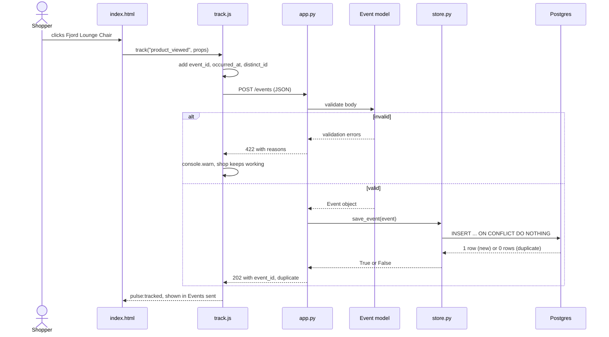
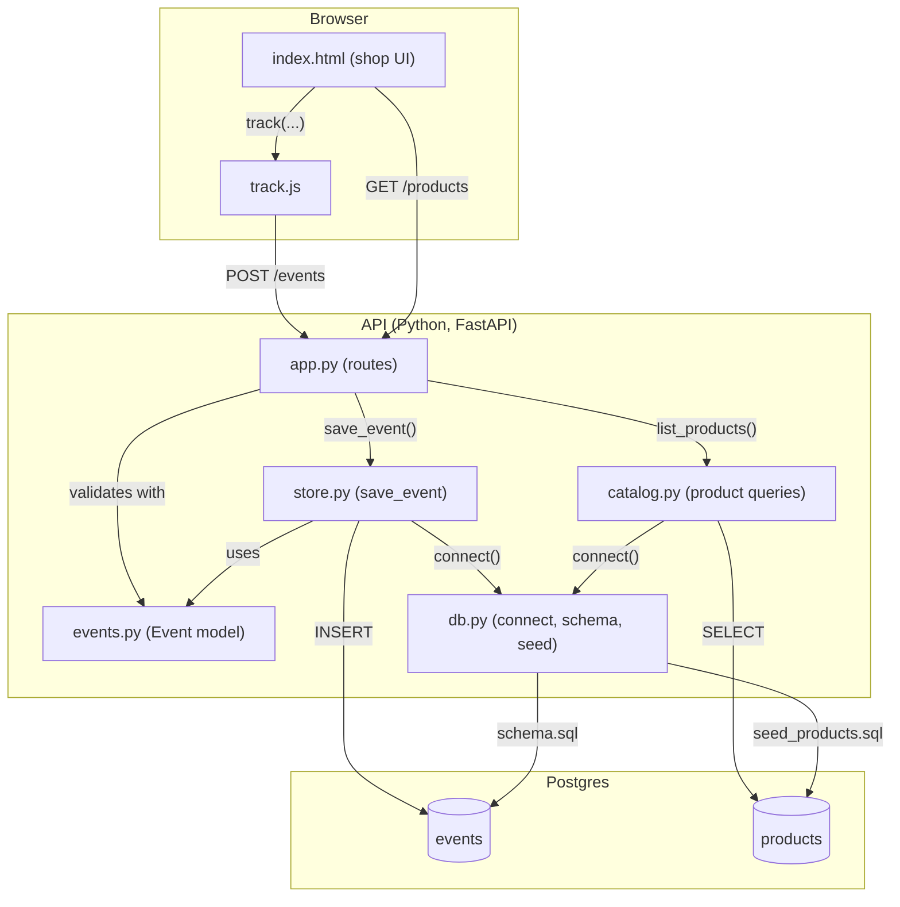
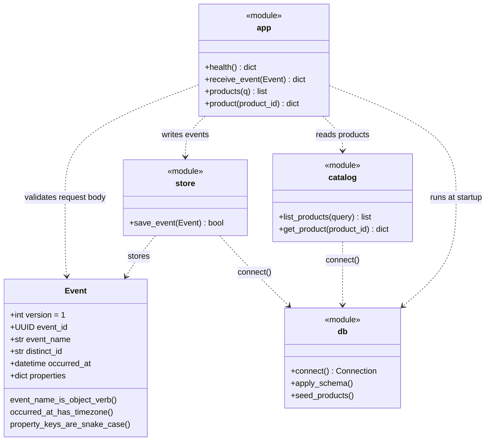
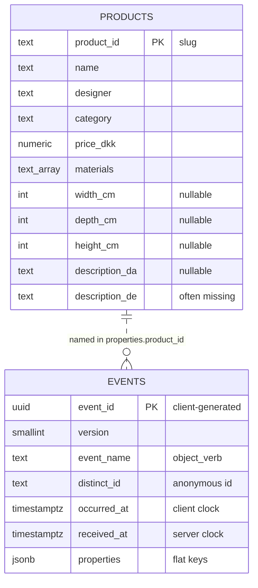
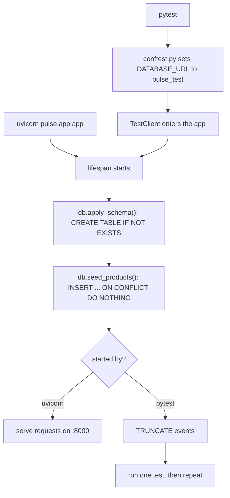
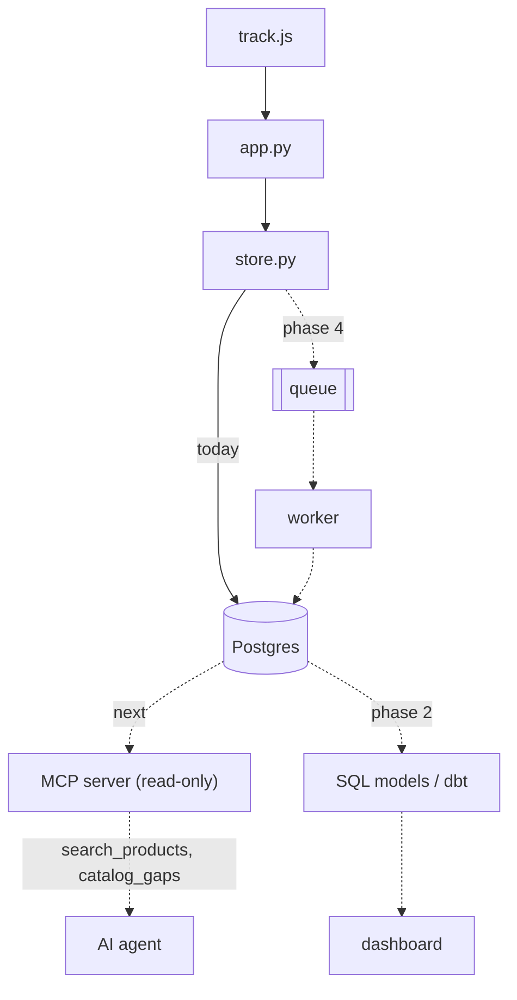

# pulse prototype: architecture

How the Python prototype in `prototype/` fits together. The diagrams are
[Mermaid](https://mermaid.js.org/); GitHub draws them, and they can be edited as text.

## Contents

1. [What happens when someone clicks a product](#1-what-happens-when-someone-clicks-a-product)
2. [Which file talks to which](#2-which-file-talks-to-which)
3. [The Event model and the modules around it](#3-the-event-model-and-the-modules-around-it)
4. [The two tables](#4-the-two-tables)
5. [Startup, and how the tests reuse it](#5-startup-and-how-the-tests-reuse-it)
6. [Where the next phases plug in](#6-where-the-next-phases-plug-in)

## 1. What happens when someone clicks a product

*UML sequence diagram.* Follow one click from the shop to a row in Postgres. Read top to bottom: each arrow is a call, dashed arrows are answers.

- **track.js** builds the whole event, including `event_id` and `occurred_at`. The server never invents those.
- **FastAPI** checks the JSON against the `Event` model before your code runs. Bad input never reaches `store.py`.
- **ON CONFLICT DO NOTHING** is what makes a retry safe: the same `event_id` twice gives one row and `"duplicate": true`.
- If anything fails, track.js only logs a warning. Analytics must never break the shop.

## 2. Which file talks to which

*Component diagram.* Arrows point from the file that calls to the file it depends on. Labels say what crosses the line.

- **app.py** is the only file that knows about HTTP. The other modules are plain Python functions you can test or reuse without a server.
- **db.py** is the only file that knows where Postgres is. Change `DATABASE_URL` and everything follows, which is how the tests use `pulse_test`.
- The browser only sees three URLs: `/shop/`, `/products` and `/events`.

## 3. The Event model and the modules around it

*UML class diagram.* Event is the one real class. The other boxes are modules, drawn as classes with a «module» stereotype so you can see their public functions.

- All validation lives in **Event**: the three validators enforce the rules from `docs/event-format.md`.
- `extra="forbid"` is why a client that sends `received_at` gets a 422.
- Dashed arrows are «uses» dependencies, not inheritance. Nothing inherits from anything here.

## 4. The two tables

*ER diagram.* events is append-only and grows with every click. products is small and changes rarely.

- The dotted line is a **soft link**: events point at products through `properties.product_id` inside the JSON, not a foreign key. That keeps the event format generic, so any event can carry any properties.
- The nullable columns in products are deliberate gaps: 5 products lack German text and 2 lack width. A future `catalog_gaps` MCP tool will find them.
- Two indexes match the two questions asked most: “how many X between dates” and “what did this user do”.

## 5. Startup, and how the tests reuse it

*Activity diagram.* The app prepares its own database on every start. The tests start the same app, so they test the real startup too.

- Both SQL files are written to be **safe to run again**: `CREATE TABLE IF NOT EXISTS` and `ON CONFLICT DO NOTHING`. That's why restarting never fails or duplicates products.
- Tests talk to a real Postgres database, `pulse_test`, instead of mocks. Slower by a second, but they catch SQL mistakes mocks would hide.

## 6. Where the next phases plug in

*Roadmap diagram.* Solid lines exist today. Dashed lines are planned. Note how much of the future hangs off store.py and Postgres.

- **Phase 4** swaps one line of responsibility: `save_event()` publishes to a queue instead of writing to Postgres. track.js, app.py and the tests don't change.
- **The MCP server** only reads. It sits next to the API, not inside it, and should use a Postgres role with SELECT only.
- **Phase 2** SQL models join events with products, for example views per product or searches with zero results.
